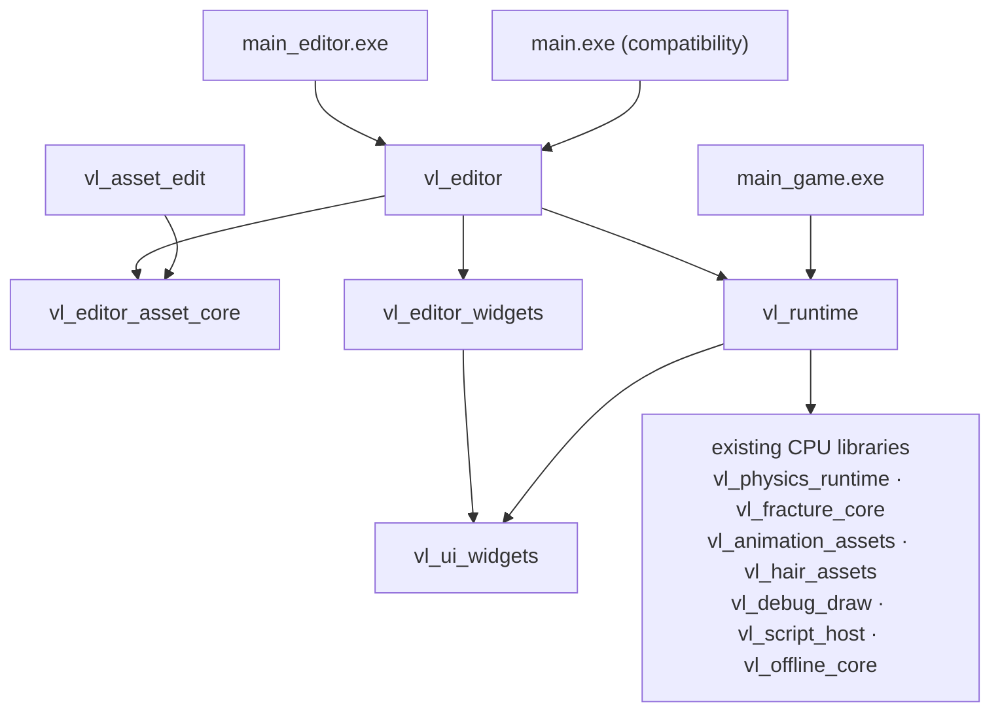

# UE-Style Runtime / Editor Split Plan

## Status

- Type: architecture implementation plan
- Created: 2026-11-10
- Base: `8f1055c` (`master`)
- Worktree: `codex/ue-runtime-editor-split`
- State: planned, not implemented
- Review verdict: **approve with changes**; both independent reviews are incorporated below
- Related:
  - `documents/plan/architecture/renderer-cohesive-runtime-extraction-plan.md`
  - `documents/contracts/vulkanlearn-architecture.html`
  - `documents/contracts/game-ui-stack.md`
  - `documents/contracts/testing.md`

This plan follows Unreal's product shape, not Android product flavors:

- Editor and game are separate build targets.
- Module dependency direction is enforced by the build system.
- Runtime data never contains editor types.
- The game package contains only the runtime dependency closure.

The plan does not claim the current repository already has these properties. It is a migration plan.

## Decision

Do **not** implement this as a large `#ifdef VULKANLEARN_EDITOR` pass over runtime code.

Target:

```text
vl_runtime  -> main_game
vl_editor   -> main_editor
```

`main_game` must not link `vl_editor` or `vl_editor_widgets`. A game build is correct only when editor
implementation units are absent from the link graph, not merely disabled at runtime.

Migration layers:

1. neutral interfaces and value DTOs;
2. editor host / runtime UI ownership seams;
3. `vl_runtime` / `vl_editor` target boundaries;
4. game packaging closure.

File decomposition of giant `.cpp` files comes after these boundaries exist.

## Goals

- `VULKANLEARN_ENABLE_EDITOR=OFF` builds and runs `main_game.exe`.
- Runtime source files cannot include or link editor implementations.
- Editor builds preserve current editor UI, docking, scene documents, MI editor, terrain editing,
  thumbnails and preview behavior.
- Game export packages `main_game.exe` and runtime-only UI/shader/resource closure.
- Runtime/editor boundaries are enforced by CMake and tests, not only by review.
- Giant source files are decomposed incrementally without behavior changes.

## Non-Goals

- No generic plugin/hot-reload framework.
- No editor as a separate process or DLL.
- No generic RHI or asset-manager abstraction.
- No global singleton removal in this plan. Inject only where the editor/runtime seam requires it.
- No gameplay, renderer, serialization or asset-format behavior changes.
- No full cook pipeline. The first packaging step covers UI and shader closure only.

## Baseline

P0 must replace these numbers with one reproducible `tool/architecture-metrics.ps1` JSON report.
Measurement method: physical `newline` count, all `.h/.cpp`, built output from a clean Release game
configuration and `--shader-force-rebuild`.

| Metric | Baseline |
|---|---:|
| `source/**` files | 714 `.h/.cpp` |
| `source/**` lines | 191,604 |
| `source/editor/**` files | 106 |
| `source/editor/**` lines | 43,388 |
| runtime `.cpp` units | 242 |
| editor `.cpp` units | 47 |
| editor widget `.cpp` units | 8 |
| `shader/glsl` | ~522,586 B |
| `shader/spv` | ~45.5 MiB after a build (gitignored) |
| `ui/` | ~213,507 B |

Largest runtime/editor units:

| File | Lines |
|---|---:|
| `source/editor/ui/materialInstanceAssetEditorPanel.cpp` | 8,972 |
| `source/renderSystem.cpp` | 6,042 |
| `source/engine/engineLoop.cpp` | 3,473 |
| `source/editor/service/materialInstanceDocumentService.cpp` | 3,117 |
| `source/ui/uiSubsystem.cpp` | 2,538 |
| `source/render/resource/rendererTerrainLoader.cpp` | 2,313 |
| `source/renderableObject.cpp` | 2,063 |

## Current Blockers

### Build shape

- `source/CMakeLists.txt:1` collects every `.cpp/.h` with one `GLOB_RECURSE`.
- `source/CMakeLists.txt:25` creates one `main` executable.
- `source/CMakeLists.txt:39` exposes the whole `source/` tree as include root.
- `source/CMakeLists.txt:61` links `vl_ui_widgets` unconditionally, including editor-only widgets.
- `source/CMakeLists.txt:30-32` applies `-Wa,-mbig-obj` to editor and runtime giant files; this must
  follow the files into their new targets.

### Runtime to editor dependencies

Direct blockers found by both reviews:

| Runtime file | Current dependency | Required seam |
|---|---|---|
| `source/renderSystem.h:40,52,97` | editor selection / preview adapter; inherits `Editor::Preview::IRendererMaterialInstancePreviewOwner` | neutral render preview/picking bridge |
| `source/renderSystem.h:42,475,672-673` | `render/editor/editorViewportGrid.h`, `DrawEditorGridGeometry`, `EditorViewportGrid` member | `IEditorViewportOverlay` injected from editor host |
| `source/ui/uiAction.h:8,262` | `editor/scene/editorActorProperty.h` | neutral actor-edit DTO |
| `source/engine/runtimeCommand.h:8,172` | transitive editor actor property through `UiAction` | neutral actor-edit DTO |
| `source/engine/runtimeCommandExecutor.cpp:17,67-90,648-649` | editor actor tree type and `ParseSceneActorIdentity` | runtime `actorIdentity` + `IEditorCommandHost` |
| `source/ui/uiSubsystem.h:18,100,324-336` | editor panel header, editor sink bases, editor members | `RuntimeUi` + `IEditorHost` |
| `source/ui/rmlUiInterfaces.h:2,107-108,144-147` | editor asset preview and full document snapshots | neutral UI external-texture/document snapshot types |
| `source/ui/uiViewModelSections.h:16-18,92-118,134-135` | editor asset/actor/MI/outliner sections | runtime/editor view-model split |
| `source/engine/engineLoop.h:23,228-247,264-265` | editor thumbnail, terrain edit/paint, scene services, actor/MI snapshots | `IEditorHost` |
| `source/engine/consoleSubsystem.h:26`; `.cpp:15-17` | `Editor::MaterialInstanceEditorRuntime*` | `EditorConsoleSink` |
| `source/engine/runtimeCommandExecutor.h:26,82,116` | `Editor::SceneDocumentService*` | `IEditorCommandHost` |
| `source/debugConsole.h:16,36`; `.cpp:12-13,17-18,32-35,108-119` | editor MI runtime and command codec | `EditorConsoleSink` |
| `source/engine/terrainEditApply.h:6,26` | `Editor::TerrainMeshUpdate` | move the whole helper to editor, not just the DTO |

Shared/runtime files that must **not** be mistakenly moved to editor:

- `source/engine/editorThumbnailPreparation.*` is used by runtime
  `blueprintAssetLoadSession.cpp:11,99`.
- `source/engine/modelPreviewCamera.*` is used every frame by `engineLoop.cpp:773`; it is runtime.
- `source/engine/blueprintPreview*` is editor-only.
- `source/ui/widgets/workspace/dockWorkspace.*` and `ui/widgets/editor/brushLibraryPanel.*` are
  editor-only and must move to `vl_editor_widgets`.

### Packaging leak

`tool/game-export/gameExporter.cpp:266-285` currently:

- copies the editor-enabled `main.exe`;
- copies the whole `shader/glsl` and `shader/spv` trees;
- copies the whole `ui/` tree;
- only sets `ui.developerUiEnabled=false`.

The exported game therefore contains editor code, editor UI assets and editor-only shaders.

### Acceptance blockers

- `--frame-limit` is a pacing limit, not a frame count; current smoke commands never terminate.
- The repository has no quit path. Add `--exit-after-frames <N>` and a console `quit` command in P0.
- A clean worktree has no `shader/spv`; packaging measurement must build first and record the build
  configuration.
- The test resource junction `..\VukanLearnResources` does not exist in this worktree; create it
  before runtime smoke/export, using the AGENTS assets-worktree convention.

## Target Architecture



### Target ownership

| Target | Owns |
|---|---|
| `vl_runtime` | platform, engine lifecycle, world, scene, render, pipeline, resource, material, mesh, shader, terrain, audio, script, runtime UI, `renderSystem.*`, `renderGraph.*`, `VulkanManager.*`, `commonFunction.h` |
| `vl_ui_widgets` | runtime-reusable RmlUi controls only |
| `vl_editor_widgets` | `dockWorkspace`, `brushLibraryPanel` and other editor-only controls |
| `vl_editor_asset_core` | editor command/service/persistence without RmlUi or GPU dependency |
| `vl_editor` | editor UI shell, panels, preview controllers, terrain editing, thumbnails, scene documents |
| `main_editor` | editor composition root; output `main_editor.exe` |
| `main_game` | runtime composition root; output `main_game.exe` |
| `main` | temporary compatibility executable; post-build copy of `main_editor.exe`, not a second compile |

`vl_editor` is a static library initially. Do not introduce an editor DLL before an ABI and destructor
order contract exists.

### CMake ownership details

- Reuse the existing filter chain for `vl_runtime`: exclude `source/physics/**`,
  `source/animation/**`, `source/debug/**`, `source/hair/**`, `source/render/offline/core/**`,
  `source/ui/widgets/**`, `script/scriptHost.cpp`, and re-add `hairSimulationPass.cpp` and
  `tressfxGroupSimulation.cpp` explicitly. Do not create a fresh unfiltered glob.
- Exclude `source/main.cpp` from `vl_runtime`. Extract `RunApplication(argc, argv,
  std::unique_ptr<IEditorHost>)` into `source/engine/application.*`; `main_editor.cpp` and
  `main_game.cpp` each define `main()`.
- `vl_runtime` PUBLIC dependencies: Vulkan headers, Eigen, Json, SDL3, RmlUi, Threads. Link
  implementation libraries explicitly; verify static-library link propagation.
- Apply the existing `copy_shaderc_dll`, `VULKANLEARN_ENABLE_*` definitions, Tracy/NVTX options and
  `vl_gameplay` dependency to both new executables through one `vl_apply_runtime_options(target)`
  helper.
- Keep `-Wa,-mbig-obj` on the files that need it after their target changes.
- `VerifyModuleSources.cmake` must allowlist library-owned directories and `tool/**` test translation
  units; otherwise it will report false unclaimed files.
- `vl_editor_asset_core` links `vl_runtime` initially (or a later `vl_foundation`) to avoid duplicate
  `contentHash`/`atomicFile`/`meshAssetValidator` symbols. `tool/asset-edit` switches to this target
  in the asset-core phase.

## Dependency Rules

Build-time rules:

1. `vl_runtime` source list has no intersection with editor source paths.
2. `vl_runtime` include root contains `source/`; it does not contain the editor source root.
3. `vl_runtime` link interface contains no `vl_editor`, `vl_editor_widgets` or `vl_editor_asset_core`.
4. `main_game` links `vl_runtime` only; its link graph contains no editor target.
5. `vl_ui_widgets` contains no `dockWorkspace.*` or `brushLibraryPanel.*`.
6. `vl_editor` may link `vl_runtime`; the reverse edge is forbidden.
7. `renderSystem.h`, `uiSubsystem.h` and `engineLoop.h` contain no editor implementation includes.
8. Runtime data (`WorldSnapshot`, `RenderScene`, `RuntimeCommand`, `UiAction`) contains no editor class
   types. Editor-facing value DTOs live in neutral bridge headers.

The include gate must cover:

```text
#include "editor/...
#include ".../editor/...
#include "render/editor/...
#include "ui/widgets/editor/...
```

Do not use a single `#include "editor/` regex that misses `render/editor` and editor widgets.

## Seam Design

### Neutral DTOs

| Current | Target |
|---|---|
| `source/editor/preview/materialInstancePreviewTypes.*` | `source/render/editorBridge/materialPreviewTypes.h/.cpp` |
| `source/editor/preview/materialInstancePreviewAdapter.h` interfaces | `source/render/editorBridge/IMaterialPreviewOwner.h` |
| `source/editor/selection/materialInstanceSelection.h` DTOs and `SceneObjectPicker` | `source/render/frontend/scenePicking.h/.cpp` |
| `source/editor/scene/editorActorProperty.h` enum/edit struct and `ApplyEditorActorProperty` | `source/scene/sceneEditTypes.h/.cpp` |
| `source/editor/ui/editorSceneActorTree.h` identity parser | `source/world/actorIdentity.h/.cpp` |
| `source/editor/assets/editorJsonAssetTypes.h` preview/thumbnail/document snapshot types | `source/ui/uiExternalTexture.h` (neutral UI DTOs) |
| `source/editor/ui/editorSceneActorTypes.h` runtime-visible snapshot subset | `source/ui/viewModel/sceneActorSnapshot.h` |
| `source/editor/ui/materialInstanceEditorView.h` runtime-visible snapshot subset | `source/ui/viewModel/materialEditorSnapshot.h` |
| `source/render/editor/editorViewportGrid.*` | editor overlay implementation behind `IEditorViewportOverlay` |

`SceneObjectPicker` moves to runtime. `RenderSystem::PickMaterialInstanceAt` calls it on the GT; the
editor only owns the selection target/router and document selection state.

### UI external textures and documents

`RmlUiRenderInterface` must not accept `EditorJsonDocumentSnapshot` or `EditorThumbnailSnapshot`.
Introduce neutral value types:

```cpp
struct UiExternalTexturePreview;
struct UiThumbnailImage;
struct UiThumbnailSnapshot;
struct UiExternalTextureSource;
struct UiDocumentSnapshot;
```

Editor code converts its asset/document snapshots into these types before publishing to RmlUi.

### `IEditorHost`

`source/engine/editorHost.h` is runtime-owned and contains no editor include.

Minimum interface:

```cpp
class IEditorHost
{
public:
    virtual ~IEditorHost() = default;

    virtual RuntimeResult<void> Initialize(const EditorHostInit&) = 0;
    virtual void Shutdown() = 0;
    virtual bool HandlePlatformEvent(const PlatformEvent&) = 0;
    virtual void Resize(uint32_t width, uint32_t height) = 0;

    virtual void Tick(const EditorFrameContext&) = 0;
    virtual void UpdateUi(const EditorFrameContext&) = 0;
    virtual void MergeUiSections(RuntimeUiViewModelSections&) = 0;
    virtual bool ApplyAction(const UiAction&, EditorActionContext&) = 0;

    virtual bool BeginActorEdit(World&, const ActorPropertyEdit&, std::string&) = 0;
    virtual void EndActorEdit(World&, const ActorPropertyEdit&) = 0;
    virtual bool CanUndo(const World&) const = 0;
    virtual bool CanRedo(const World&) const = 0;

    virtual std::optional<std::string> DraftWorldDocument(const World&) const = 0;
    virtual void NotifyWorldChanged(std::string_view, uint64_t) = 0;
    virtual void NotifyWorldLoadCompleted() = 0;

    virtual bool SelectSceneObjectFromPick(const ScenePickResult&) = 0;
    virtual void ClearSelection() = 0;
    virtual void BuildSceneActorSnapshots(
        const World&, std::vector<EditorSceneActorSnapshot>&) const = 0;
    virtual void BuildSceneModelSnapshots(
        const RenderScene&, std::vector<MaterialInstanceModelSnapshot>&) const = 0;

    virtual void TickMaterialInstanceEditor() = 0;
    virtual void TickThumbnails() = 0;
    virtual bool CanRenderThumbnails() const = 0;
    virtual IEditorViewportOverlay* ViewportOverlay() = 0;
    virtual EditorConsoleSink* ConsoleSink() = 0;

    virtual bool IsEnabled() const = 0;
    virtual bool IsVisible() const = 0;

    virtual void BuildDockingDocument(
        Rml::Context&, const World&, const RuntimeUiViewModelSections&) = 0;
};
```

`EditorHostInit` must include `PlatformWindow*`, `CommandBus*`, `DiagnosticsSubsystem*`,
`RuntimeConfig*`, `WorldManager*`, `ScriptRuntimeSubsystem*`, `RenderSystem*`,
`RendererBackendVulkan*`, `PipelineFactory*`, `RuntimeUi*` and the editor UI descriptor.

`NullEditorHost` is the game implementation. `ApplyAction`, selection and document hooks return false
or do nothing; `IsEnabled` and `IsVisible` return false; `--dev-ui` in a game binary is a no-op or a
clear startup error, never an editor document load.

### Runtime UI / Editor UI

Keep one process-wide RmlUi runtime and one `Rml::Context` per window initially. Split ownership, not
contexts:

| Owner | Responsibility |
|---|---|
| `RuntimeUi` | `Rml::Initialise/Shutdown`, context creation, fonts, localization, `runtime-hud.rml`, input arbitration, one `Context::Update` per frame, HUD snapshot publish, scene viewport rect |
| `EditorHost` / `EditorUi` | `editor-workspace.rml`, panels, docking, asset browser, editor view models, editor input handling |

Frame order:

1. `RuntimeUi` handles platform events and input ownership.
2. `EditorHost::UpdateUi` mutates editor DOM only.
3. `RuntimeUi::Update` performs the single `Context::Update` and publishes the frozen UI snapshot.
4. `EditorHost::Shutdown` detaches editor documents before `RuntimeUi::Shutdown` removes the context.

Runtime sections and editor sections use stable `UiSectionId` values but separate aggregates:

- runtime: scripts, performance, viewport camera, environment/lighting, offline, status;
- editor: animation preview, outliner, assets, thumbnail/document snapshots.

`EditorHost::MergeUiSections` merges editor section versions into the runtime refresh mask.

`localization.json` stays one file in the runtime manifest for now. Editor-only entry pruning is a
later code change, not a packaging-only split.

### Editor grid and selection mask

Preferred and planned: `RenderSystem` holds an optional `IEditorViewportOverlay*`; the editor
implements grid creation, resize and recording. `PassRuntimeServices::DrawEditorGridGeometry`
delegates to it. Game config has no `editorGrid` pass.

Fallback only if the overlay seam proves too large: one explicit `VULKANLEARN_WITH_EDITOR` branch
around `EditorViewportGrid`, registered as the single boundary exception. Do not scatter editor
`#if` checks.

## Packaging

### UI manifests

Add:

- `ui/runtime-ui.manifest.json`: `runtime-hud.rml`, `runtime-hud.rcss`, `localization.json` and any
  runtime icons/fonts actually referenced.
- `ui/editor-ui.manifest.json`: `editor-workspace.*`, editor widgets, editor icons and editor-only
  assets.

The exporter copies a manifest closure, not a directory tree. It must scan `.rml` `href`/`src` and
`.rcss` `url()`/`@import`; a missing referenced file fails before staging is published. Do not blanket
ban `ui/widgets/**`; use the reference closure and explicitly reject editor-only filenames.

### Shader closure

The closure must be driven by the **actual required shader name set**, not by a guessed `kind` or
`primarySources` path.

Rules:

- `shader/spv/shader-build-cache.json` must exist; without it game export fails. Dev flavor may
  explicitly fall back to a full tree.
- `ShaderBuildArtifactRecord.kind` values are `StageEntry`, `GraphicsPair`,
  `MaterialGraphicsPair`, not `material`/`pass`/`compute`.
- Material-composed artifacts map to an `M_*.json` through `normalizedKey` containing
  `materialSource=<path>`; `primarySources[].identity` may be `__composed__/...` and must not be used
  as the M_ path.
- Ship every `M_*.json` resolved from a shipped MI, plus its `shaderEvaluation` vertex/surface files.
- `**/generate/` parameter includes are rebuilt at startup; do not package them, but verify generated
  output is reproducible and includes the same parameter schema.
- Keep **all output roles**, including `debugVertex`, `debugFragment`, `debugCompute`. They are
  required by `graphicsShaderVariantArtifact.cpp`, `computeShaderArtifact.cpp`, cache validation and
  ABI reflection. Do not drop `*.debug` SPV.
- Skip only unreferenced artifacts, not debug outputs.
- Copy `shader-build-cache.json` itself; the package manifest must include its digest.
- `compilePolicy` must match the game binary's build configuration. Generate the game cache from the
  Release game build with `--shader-force-rebuild`; exporter rejects a Debug/Release mismatch.
- The packaged smoke must report `misses=0`, `compiled=0`, `failed=0` and no `Shader cache miss:`.

### Gameplay default materials

`source/world/loading/worldGameplayPlanBuilder.cpp:57` defaults glass crack to
`Common/Materials/MI_glass_crack.json`, but `SC_fracture_playground` does not spell it out in scene
JSON. The exporter must include it:

- reuse `CollectGameplayMaterialRequests` or a shared gameplay default-material list;
- add `PackagedGameplayDefaultMaterialIsIncludedTest`.

### Flavor marker and export

CMake writes `vl_build_flavor.json` next to each binary:

```json
{"flavor":"game","editorEnabled":false,"withEditorMacro":0}
```

`vl_export_game --flavor game` requires `main_game.exe` and `editorEnabled=false`; it rejects
`main.exe`. `--flavor dev` may use `main_editor.exe` and a full asset tree. Export tests default to
`dev` so existing fixtures do not require a shader cache; game-flavor tests use a dedicated fixture.

### Package validation

Add `tool/validate-game-package.ps1` and register it with CTest:

- parse `game-export-manifest.json` and `runtime-shader.manifest.json`;
- assert every retained artifact's output roles, digests and M_/shaderEvaluation dependencies exist;
- assert no `ui/editor-workspace.*`, editor-only widget file or editor-only icon is referenced;
- assert no `shader/glsl/pass/editorGrid.*`, `pass/M_editorGrid.json`, or
  `resources/Common/Materials/Pass/MI_editorGrid.json`;
- assert `renderGraphConfig.json` has no `editorGrid` pass but still has `selectionMask`, because
  `toneMapping.frag` samples it;
- assert `vl_build_flavor.json.editorEnabled == false`;
- assert package content does not include files outside the declared manifest;
- launch the packaged game with `--exit-after-frames 300` and assert exit code 0,
  `EngineLoop teardown complete`, `misses=0`, no `Shader cache miss:`, no validation/VUID/threading
  errors;
- assert export does not mutate the project tree (`git status` before/after).

## File Decomposition

These splits happen after the target boundary is stable.

### `renderSystem.cpp`

Keep `source/renderSystem.*` as the facade. Extract:

- `source/render/shadow/csmRuntime.*`
- `source/render/postprocess/postProcessControls.*`
- `source/render/environment/environmentRuntime.*`
- `source/render/offline/offlineRenderRuntime.*`
- `source/render/frame/renderWorldSnapshot.*`
- `source/render/frame/renderFrameRecorder.*`
- `source/render/terrain/terrainFeedbackRuntime.*`
- `source/render/hair/hairRuntime.*`
- `source/render/picking/renderPicking.*`
- `source/render/preview/materialPreviewRuntime.*`

Follow the existing extraction plan order. Preserve async GT/RT semantics: `csmSettingsMutex`,
`csmSettingsRevision`, `frameCsmSettings`, `SnapshotFrameCsmSettings`, `RendererResourceCache::LockForFrame`
and the safe-point rules. CSM extraction requires a concurrent setter + RT snapshot regression test.

### `engineLoop.cpp`

Keep `EngineLoop` as lifecycle/frame orchestration. Extract:

- `source/engine/frame/engineFramePhases.*`
- `source/engine/ui/engineUiViewModel.*`
- `source/engine/ui/engineUiActions.*`
- `source/engine/script/engineScriptBuild.*`
- `source/engine/blueprint/engineBlueprintAssets.*`
- `source/engine/window/engineWindowLifecycle.*`
- `source/engine/perf/enginePerformance.*`

Move editor-only members behind `IEditorHost`: terrain edit/paint, thumbnails, scene documents,
MI editor runtime, editor selection and editor view models. Keep `ModelPreviewCamera` in runtime.
Keep `editorThumbnailPreparation.*` in runtime because blueprint asset loading uses it.

### `materialInstanceAssetEditorPanel.cpp`

Keep the current panel as the facade. Extract:

- `panel/editorPanelBootstrap.*`
- `panel/editorPanelCommandBridge.*`
- `panel/sceneOutlinerView.*`
- `panel/sceneDetailsView.*`
- `panel/sceneViewportController.*`
- `panel/terrainPanelController.*`
- `panel/hairPanelController.*`
- `panel/materialEditorView.*`
- `panel/blueprintAssetView.*`
- `panel/editorPanelActionRouter.*`
- `panel/actorMarkup.*`

Split markup/view first, then the click/change action router last.

### Other decompositions

- `materialInstanceDocumentService.cpp` -> paths, IO, validation, overrides, asset catalog, snapshot,
  batch and scene material resolver.
- `uiSubsystem.cpp` -> `rmlUiContextHost`, `runtimeUi`, `uiInputArbiter`, `editorUiShell` and view
  model value types.
- `renderableObject.cpp` -> mesh buffers, TressFX renderable, simulation binding, clone helper and
  the small draw facade.
- `rendererTerrainLoader.cpp` -> upload rings, atlas resources, page upload, layer page upload,
  source sets and facade.

## Migration Phases

Each phase is one PR-sized change. Do not combine a behavior change with a file move.

| Phase | Content | Exit gate | Rollback |
|---|---|---|---|
| P0 | Metrics script, `--exit-after-frames`, console `quit`, resource junction, baseline package/build | Baseline JSON; both editor and game builds; smoke commands terminate | Delete scripts/commands |
| P1 | Neutral DTOs: preview, picking, actor edit, actor identity, UI external textures; old forwarding headers | New neutral headers compile; full build/tests; old headers still work | Revert P1 |
| P2a | Header neutrality: `renderSystem.h`, `uiAction.h`, `runtimeCommand.h`, `rmlUiInterfaces.h` | Header-only include gate; build/tests | Revert P2a |
| P2b | Pimpl/header seams for `uiSubsystem.h`, `engineLoop.h`; `render/editor` overlay interface | Build/tests; `.cpp` may still include editor temporarily | Revert P2b |
| P3a | `IEditorHost` + `NullEditorHost` + `EngineLoop::Init` injection; `EditorHost` wraps existing editor behavior | Editor build/tests; game still builds single target | Revert P3a |
| P3b | `RuntimeUi` / `EditorUi` split; runtime/editor view-model aggregates | Editor UI tests, runtime HUD tests, input order tests | Revert P3b |
| P3c | Move script authoring, outliner, thumbnails, terrain edit/paint, picking/preview camera editor hooks to host | `rg` runtime source has no editor include; editor/runtime tests | Revert P3c |
| P4a | Physical move of editor sources and editor-only engine/render/widget files; update all tool CMake paths, routing, diagrams | Editor build/tests; `validate-docs.py` passes | One `git mv` revert |
| P4b | `vl_runtime` / `vl_editor` / `vl_editor_widgets` / `main_editor` / `main_game`; compatibility `main` copy | `main_game` links without editor target; editor and game build | Revert P4b |
| P5 | `vl_editor_asset_core`; asset tools/tests link libraries instead of source globs | `vl_asset_edit`, editor tests, material editor tests | Revert P5 |
| P6a | UI manifests, shader closure, package validator; `--flavor dev` allowed | Export tests and package validator | Revert P6a |
| P6b | Require `main_game.exe` + CMake flavor marker; game package smoke | Game package runs `SC_fracture_playground` with `misses=0` | Revert P6b |
| P7 | `renderSystem` extraction: CSM/post/environment | CSM/environment regressions; concurrent CSM test | Each sub-PR |
| P8 | `renderSystem` extraction: snapshot/frame/terrain/hair/picking/preview | world transaction, frame budget, retire, MI preview tests | Each sub-PR |
| P9 | `engineLoop` extraction and compatibility forwarding | editor/game smoke, runtime tests | Each sub-PR |
| P10 | `materialInstanceAssetEditorPanel` decomposition | editor UI tests, markup/action goldens | Each sub-PR |
| P11 | Document service and remaining editor services | material editor test targets, JSON goldens | Each sub-PR |
| P12 | Runtime leaf splits: `renderableObject`, terrain loader | hair/renderer/terrain tests, runtime smoke | Each sub-PR |
| P13 | Architecture contract, AGENTS, routing, testing, boundary rules, archify | `validate-docs.py`, boundary audit, rule index check | Docs-only revert |

### P4b implementation note (2026-11-10)

P4b landed target ownership, entry points and include gates **without the P4a physical moves**.
The active worktree count makes directory-wide `git mv` conflict-heavy; `source/editor/**`,
`source/render/editor/**` and the editor widget files stay where they are, but only `vl_editor`
compiles them. `vl_runtime` filters those paths from its source glob and rejects editor-only
includes at configure time. Move the files when the long-lived branches converge.

P4b also filters the `editorGrid` render-graph pass and its shader pair in game builds. That is an
explicit flavor seam until P6a computes the packaged shader closure from a manifest.

### P5 implementation note (2026-11-11)

P5 added `vl_editor_asset_core` (STATIC) over `source/editor/{command,service,persistence}/**`,
linked `PUBLIC vl_runtime` and applied `vl_apply_runtime_options`. `vl_editor` no longer compiles
those three directories, `tool/asset-edit` links the library instead of nine source entries, and the
material-instance editor tests link it in the main build while keeping their inline source list for
standalone configuration. `editor_ui_tests` (26 duplicated runtime TUs), `script_tests` (21) and
`terrain_tests` (31) keep their self-contained runtime slices; `editor_viewport_tests` only inlines
one runtime TU and consumes no asset-core source. Migrating those four belongs to the follow-up
that lets them link `vl_editor` directly.

### Phase-specific rules

- P1/P2 must not promise all runtime headers are clean; P1 only adds neutral headers and forwarding,
  P2a only cleans the headers listed. P2b may still leave implementation includes.
- P3a/P3b/P3c are separate because `UiSubsystem` + `EngineLoop` + panel are too large for one PR.
- Entry-point split belongs to P4b, not P3a; do not create two `main()` functions in one target.
- P4a must update `tool/asset-edit`, `tool/editor-ui-tests`, `tool/material-instance-editor-tests`,
  `tool/script-tests`, `tool/terrain-tests`, `tool/editor-viewport-tests`, routing and diagram sources
  in the same commit.
- Do not move `editorThumbnailPreparation.*` or `modelPreviewCamera.*` in P4a.
- P4b must split `vl_editor_widgets` before the game binary is considered editor-free.
- Keep a compatibility `main.exe` by post-build copy; do not compile a second 300-TU executable.
- Each phase that changes a diagram-referenced file updates the diagram JSON/HTML and runs
  `validate-docs.py`; do not defer all docs to P13.

## Acceptance

### Build matrix

```powershell
$root = 'D:\YYBWorkSpace\GitHub\VulkanLearn-worktrees\ue-runtime-editor-split\VulkanLearn'
$env:TEMP = "$root\.tmp"
$env:TMP = $env:TEMP
$env:NUGET_SCRATCH = "$root\.nuget-scratch"
$env:CMAKE_BUILD_PARALLEL_LEVEL = '4'

# editor only
cmake -S $root -B "$root\build-editor-only" -G "MinGW Makefiles" `
  -DVULKANLEARN_ENABLE_EDITOR=ON -DVULKANLEARN_BUILD_GAME=OFF `
  -DVULKANLEARN_BUILD_TESTS=ON

# both
cmake -S $root -B "$root\build-editor" -G "MinGW Makefiles" `
  -DVULKANLEARN_ENABLE_EDITOR=ON -DVULKANLEARN_BUILD_GAME=ON `
  -DVULKANLEARN_BUILD_TESTS=ON

# game only, Release
cmake -S $root -B "$root\build-game" -G "MinGW Makefiles" `
  -DVULKANLEARN_ENABLE_EDITOR=OFF -DVULKANLEARN_BUILD_GAME=ON `
  -DVULKANLEARN_BUILD_TESTS=OFF -DCMAKE_BUILD_TYPE=Release

# invalid: both OFF must fail configure
```

Also build with C# enabled and smoke `--worker-thread-count 1` and `2`.

### Smoke

```powershell
build-editor\bin\main_editor.exe --dev-ui `
  --initial-scene Maps/SC_fracture_playground/SC_fracture_playground.json `
  --exit-after-frames 300
build-game\bin\main_game.exe --no-dev-ui `
  --initial-scene Maps/SC_fracture_playground/SC_fracture_playground.json `
  --exit-after-frames 300 --worker-thread-count 2
build-game\bin\main_game.exe --world-graph-transaction-test --exit-after-tests --no-dev-ui
```

### Tests

- Existing editor UI, material editor, game export, renderer backend, terrain and script tests.
- Runtime tests: `--world-graph-transaction-test`, `--shader-reload-test`,
  `--shader-compute-reload-test`, game `SC_fracture_playground`.
- New named tests:
  - `RuntimeModuleBoundaryTest` (editor/render-editor/editor-widget includes);
  - `GameFlavorLinkTest` (`link.txt` no `vl_editor`; `nm -C` no editor classes);
  - `NullEditorHostTest` and `UiInputOrderTest`;
  - `RuntimeHudWithoutEditorAssetsTest`;
  - `ShaderClosureTest` with `ExcludesEditorGridArtifact`, `ExcludesOfflineMaterials`,
    `RetainsGraphPassShaders`, `KeepsDebugOutputs`, `RequiresMaterialDefinitionJson`,
    `RequiresGeneratedIncludeDeterminism`;
  - `GameFlavorRejectsEditorBinaryTest`, `GameFlavorDoesNotMutateProjectTreeTest`,
    `GameFlavorKeepsSelectionMaskAndToneMappingTest`;
  - `PackagedGameplayDefaultMaterialIsIncludedTest`;
  - `CsmExtractionGoldenTest` with concurrent GT setter / RT snapshot;
  - `PanelMarkupGoldenTest`, `DocumentServiceGoldenTest`,
    `TressfxRenderableBufferLayoutTest`, `TerrainUploadCopyRegionGoldenTest`.

### Gates

```powershell
py -3 tool\validate-docs.py
powershell -NoProfile -ExecutionPolicy Bypass -File tool\architecture-boundary-audit.ps1
py -3 tool\generate_boundary_rule_index.py --check
powershell -NoProfile -ExecutionPolicy Bypass -File tool\validate-game-package.ps1 -Package artifacts\game-package
```

### Metrics

| Metric | Current | Target |
|---|---:|---|
| Runtime -> editor include sites | 8 header areas + implementation uses | 0 |
| Runtime -> editor link edges | 1 monolithic target | 0 |
| Game binary | editor-enabled `main.exe` | `main_game.exe` without editor units |
| Game UI assets | whole `ui/` | runtime manifest closure |
| Game shader assets | whole `shader/glsl` + `shader/spv` | required artifact closure; all output roles retained |
| Giant files | up to 8,972 lines | each responsibility file <= ~1,500 lines |
| Compile units | ~306 | game ~242; editor ~306 |

Binary size, SPV bytes and build-time targets are measured in P0 and become thresholds only after a
reproducible baseline.

## Risks

| Risk | Handling |
|---|---|
| Active worktrees modify `renderSystem.*`, `engineLoop.*`, panel, `renderableObject.*`, UI | Land P1/P2 first; rebase before P7+; serialize giant-file work; P4a may conflict with many `terrain-*` branches |
| RmlUi global lifecycle / input order | `RuntimeUi` owns context and one `Context::Update`; editor detaches first |
| Preview adapter lifetime around RenderSystem shutdown | `IEditorHost::Shutdown` before RenderSystem teardown; null host registers nothing |
| Editor grid / selection mask in runtime graph | `IEditorViewportOverlay`; if a `#if` fallback is used, register one explicit boundary exception |
| Debug SPV removed accidentally | cache/ABI reflection require debug outputs; package and verify every output role |
| Missing M_ / shaderEvaluation / generate includes | include M_ JSON and shaderEvaluation sources; rebuild generated includes at startup |
| Cache compilePolicy mismatch | generate Release game cache; exporter validates policy/marker; smoke asserts zero misses |
| Glass crack default material missing | exporter includes gameplay default materials; add packaged test |
| Shader manifest drift | generate from build cache; fail on missing artifact; dev flavor full-tree fallback |
| Editor tests recompile editor sources | link `vl_editor` / `vl_editor_asset_core`; independent test CMake projects need generated source lists or main-build integration |
| Physical move huge diff / merge conflicts | P4a `git mv` only; update tool CMake/docs/diagrams in same PR; coordinate with active branches |
| Compatibility `main` doubles build time | post-build copy, not a second executable |
| CMake options/dependencies lost on new targets | one `vl_apply_runtime_options`; preserve big-obj, shaderc DLL, Tracy/NVTX, `vl_gameplay` |
| Read-only install directory / project cache mutation | exporter uses a cache snapshot and verifies project tree unchanged |
| Resource junction absent | create assets worktree/junction in P0 before runtime smoke/export |

## Anti-Patterns

- Do not use `--frame-limit` as a frame count.
- Do not use log strings alone as the editor-leak proof.
- Do not let the exporter synthesize its own flavor marker.
- Do not drop debug SPV or the M_ definition JSON.
- Do not use “keep all non-material artifacts” as a closure rule.
- Do not move `ModelPreviewCamera` or `editorThumbnailPreparation` into editor.
- Do not blanket-ban `ui/widgets/**` in packaging; validate the reference closure and editor-only
  filenames.
- Do not recompile a second full binary just to keep `main.exe`.
- Do not put editor types into `WorldSnapshot`, `RenderScene`, `RuntimeCommand` or `UiAction`.
- Do not delete `selectionMask` without changing `shader/glsl/pass/toneMapping.frag`.
- Do not hand-maintain shader lists; use the build-cache manifest.
- Do not split giant files before their target ownership is settled.

## Review Record

Independent reviews:

1. **Architecture/CMake review**: approve with changes. Blocking issues were missing runtime→editor
   blockers (`render/editor`, `runtimeCommand.h`, actor identity, console subsystem, engineLoop
   snapshots, UI outliner/assets sections, RmlUi full document snapshot, terrain apply, widget split),
   insufficient `IEditorHost`, unreachable P1/P2/P3 gates, and incomplete CMake ownership/options.
2. **Packaging/acceptance review**: reject as written, direction approved. Blocking issues were
   dropping required debug SPV, omitting `M_*.json`, wrong artifact mapping/`kind` fields, cache
   `compilePolicy` mismatch, non-terminating smoke commands, missing glass-crack default material,
   CMake filter duplication, and incomplete package assertions.

This revision addresses both reviews. The remaining decisions are listed below and must be closed in
P0 before P1 starts.

## Decisions Required Before P1

1. **Physical move timing**: P4a uses `git mv` after P3; if active worktree conflicts are too high,
   keep target ownership and strict include gates first, then move when branches converge. Do not
   keep editor forwarding headers after the move.
2. **Editor grid**: use `IEditorViewportOverlay`; fallback to one registered `#if` exception only if
   the overlay cannot be isolated in P2b/P3.
3. **Asset core**: `vl_editor_asset_core` links `vl_runtime` initially; introduce `vl_foundation` only
   if asset tools need a runtime-free subset.
4. **Compatibility `main`**: post-build copy from `main_editor.exe`; delete after the documented
   transition window.
5. **Shader closure source of truth**: `shader-build-cache.json` plus MI material paths; add an
   explicit `materialSource` field to the manifest if `normalizedKey` parsing proves fragile.
6. **P0 command surface**: add `--exit-after-frames` and console `quit` before any smoke/packaging
   acceptance is automated.
