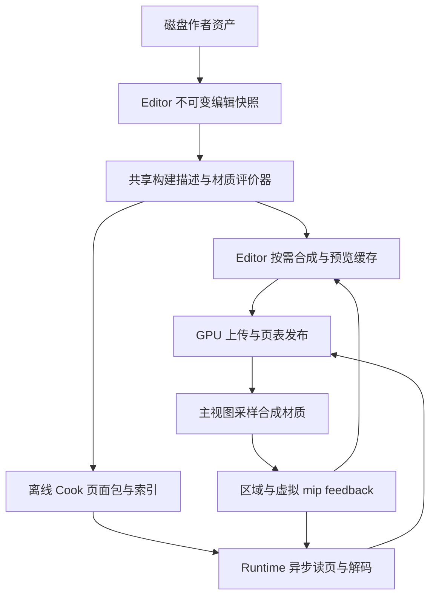

# 地形合成 VT：Editor / Cook / Runtime 资源生命周期计划

> 后续范围修订：用户要求完整 16 地块使用新系统，并删除旧运行路径。
> 此修订优先于下方初始“旧路径对照开关”提案，实施与新验收见
> [完整岛屿切换记录](../../rationale/terrain-full-island-cutover.md)。
> 下方 2×2 交付收据为前一阶段历史，不代替完整岛屿。

> 最新执行记录：2026-11-20 的实施与验收见 §15，
> [最终证据](../../rationale/terrain-composited-vt-final-evidence.md) 和
> [独立审计](../../rationale/terrain-composited-vt-completion-audit.md)。
> 以下“尚未实施/只交付计划”是初始提案时的历史状态，不是当前实施状态。

> 状态：设计提案，已完成源码对照与本文内部一致性审阅，待用户审阅；尚未实施，非契约。
> 日期：2026-11-19。源码对照基线：`codex/terrain-openworld`，HEAD `5df9fbc`。
> 本文不代表当前能力；现状以 [terrain 契约](../../contracts/terrain.md) 和源码为准。
> 本轮只交付计划，不修改运行时、资产或现有资源格式。

## 1. 目标与范围

目标是先理清资源生产、所有权、流转、刷新与退休，再把当前“覆盖权重分页 +
层源纹理分页 + 主视图混合”迁移为“按地形区域缓存合成材质属性”的 VT。

用户观察到的近处大、远处小，落实为同一区域在不同虚拟 mip 下具有不同有效分辨率；
物理缓存页仍使用固定尺寸。主视图读取合成后的 albedo、normal、ORM；
光照、阴影和雾继续在正常渲染管线计算，不烘进材质页。

第一版覆盖静态地形、Editor Paint/Sculpt 预览、离线 Cook 与只读 Runtime 消费。
不承诺运行时动态绘制、任意时变材质、跨机器逐位一致的 GPU 生成结果。
几何 LOD、碰撞、材质 VT 分别管理，使用同一作者快照作为依赖来源。

## 2. 现状核对与问题

| 当前资源/流程 | 源码入口 | 当前语义与缺口 |
| --- | --- | --- |
| 高度、层定义、Paint | `source/terrain/terrainAssetLoader.cpp`、`terrainAssetTypes.h` | 加载为 CPU 计划/快照；是生成来源，不是 GPU 缓存 |
| 覆盖页 | `source/terrain/terrainPageManager.cpp` | 分页存 top-4 ID/权重，不是最终合成材质 |
| 覆盖页 GPU bake | `source/render/resource/terrainPageBakeGpu.cpp` | 烘焙覆盖信息，不能当作完整材质页构建器 |
| 层源纹理 VT | `source/render/resource/terrain/terrainLayerPageUpload.cpp` | 从完整 GPU 源数组 copy 到层 atlas，仍保留源数组 |
| 最终混合 | `shader/glsl/materialFunction/mf_terrainLayerBlend.glsl`、`mf_terrainLayerVT.glsl` | 主视图逐像素读取多层、混合材质 |
| Feedback | `shader/glsl/pass/terrainFeedback.frag` | 覆盖页与层页两套需求，不是合成材质页需求 |
| 每帧回读与请求 | `source/render/terrain/terrainFeedbackRuntime.cpp` | frame fence/epoch 后消费，逐帧限流 |
| Paint/Sculpt 刷新 | `source/editor/editorHost.cpp` | 修改 World/plan/bake 输入，失效整个 placement 的已驻留覆盖页 |
| 保存 | 同上及 terrain writer/file 模块 | 保存作者数据，不等同于生成发布用的材质 VT 包 |

源码审阅发现的迁移风险：

1. feedback 读取覆盖 atlas 时使用虚拟页坐标，主材质使用页表解析的物理坐标；
   非恒等映射下会产生错误层需求。
2. 自动层 mip 使用覆盖页 UV，未跟随实际层纹理 UV 平铺密度。
3. 逐层权重数组模式与 feedback 的 top-4 来源不同；局部层 slice 与全局层 ID
   也需要显式映射，不能默认相等。
4. 层页预算按整个 `(layer,mip)` 页集分配，局部可见需求会扩成整层需求。
5. 现有 revision、batch pin、quarantine 有局部保护作用，但不能替代贯穿作者快照、
   构建任务、磁盘缓存、GPU 发布的内容版本。

这些是源码分析结论，尚非当前版本的画面复现结果。旧测试程序的通过结果不能替代
新链路的验证。旧路径若继续作为对照，必须先修复相关正确性问题。

## 3. 资源分类与所有权

以下角色和资源均为目标设计，不表示已有同名类。

| 资源 | 真值/来源 | 持有者 | 持久化 | 刷新原则 |
| --- | --- | --- | --- | --- |
| 作者资产 | 高度图、权重/Paint、层材质与规则、TR | 资产系统 | 必须 | 保存只写作者资产 |
| 编辑快照 | 作者资产 + 未保存操作 | Editor 地形文档 | 显式保存 | 不可变 revision；Undo/Redo 也产生新 revision |
| 构建描述 | 固定作者快照 + 配置 + 依赖摘要 | 共享地形构建模块 | manifest | 所有输出可追溯到相同输入 |
| 网格/LOD | 高度与几何配置 | 几何构建/streaming | 可 Cook | 与材质缓存分别更新 |
| 碰撞数据 | 宏高度与碰撞配置 | 物理构建/World | 可 Cook | 与渲染几何分别发布 |
| 合成材质页 | 区域、虚拟 mip、层混合结果 | 构建模块/派生缓存 | Cook 页面包 | 无光照；含 border 和编码信息 |
| tiling 高度页 | 可重复平铺的层高度源，不按地形区域合成 | 构建模块/派生缓存 | Cook 高度数据 | 按源内容去重，保留物理幅度与采样约定 |
| 页面索引 | 虚拟布局、页位置、格式、依赖摘要 | Cook manifest | 必须 | 与页面包原子发布 |
| CPU 页面缓存 | 已读/已解码的合成页 | Runtime streaming | 否 | 有字节预算，淘汰不改内容 |
| GPU atlas/页表 | 页面缓存的当前 GPU 映射 | Renderer，World-local | 否 | fence/epoch 保护发布与槽位复用 |
| 常驻 height atlas/映射 | 当前 World 使用的 tiling 高度页 | Renderer，World-local | 否 | 固定保留槽位，不参与材质页 LRU |
| Feedback/request | 视图对合成页的需求 | Renderer/streaming | 否 | 可合并、丢弃过期需求，不改作者数据 |

关键界限：

- 合成页是内容，atlas 是内容的驻留位置；驱逐 atlas 页不等于内容失效。
- Editor UI 只提交编辑操作，不直接改页表或 Vulkan 资源。
- 文档快照是编辑真值；World 和构建器消费快照，不各自成为独立编辑真值。
- 资源共享按内容身份判断，不因“同一 TR”就共享所有输出。
- 宏高度、tiling 位移高度、物理碰撞高度分别命名；tiling 高度接入 VT 资源体系，
  但不把合成材质 VT 的距离 mip 用作碰撞或顶点位移高度。

## 4. 页面空间、mip 与过滤

### 4.1 页面身份

逻辑地址定义为 `(terrainSurfaceId, virtualMip, pageX, pageY)`；
内容身份另外包含依赖摘要、生成器版本和编码配置。GPU 物理槽位不参与内容身份。

采用地形局部 XZ 的归一化表面参数域，虚拟 mip0 分辨率由地形尺寸与目标
texels/m 配置确定，之后逐级减半至尾部。非正方形地形分别记录 X/Y 分辨率。
溢出边界、最后一页有效范围及 border 的采样规则必须写入构建描述。

若合成使用世界高度、坡度或世界投影，影响结果的 placement 变换纳入依赖摘要。
相同 TR 不同摆放只有在依赖摘要一致时才共享派生内容；不先承诺跨摆放去重。

### 4.2 物理布局

原型以固定 `128×128` 有效 texel 和每边 `4 texel` border 起步；
最终格式/尺寸由 S1 验证决定，BC 页存储 extent 必须满足块对齐。
border 从相邻虚拟区域生成，不能用本页边缘复制替代内部跨页连续性。
地形外缘使用明确的 clamp 规则；只有作者声明平铺时才 wrap。

同一区域近处可能使用 `8×8` 页，远处只用一页；每个物理页大小相同。
物理 atlas 第一版不生成普通 mip 链，避免不同内容的相邻物理页混合。
虚拟 mip 由页面索引与页表寻址；三线性过滤由两个虚拟层级显式采样实现。
各向异性支持范围必须受 border 限制并实测，不默认继承普通纹理的最大值。

### 4.3 材质语义

- albedo 在正确线性空间混合；存储颜色空间由格式描述明确。
- normal 第一版采用地形局部坐标基，过滤后归一化，主视图变换至世界空间；
  世界投影等依赖仍按实际输入记账。与现有 TBN/细分路径的等价性由 S1 验证。
- ORM 的通道顺序、混合公式与现有材质统一；不得把不同历史约定直接拼接。
- 粗 mip 定义为共享材质评价器的抗混叠面积过滤结果，不能只低分辨率点采样；
  normal/roughness 的滤波规则单独固定。细节最终随分辨率降低消失属于预期。
- 顶点位移不烘入合成材质页，由下一节的 tiling 高度缓存提供；透明、
  视角相关和时间相关项不进入第一版合成材质缓存。检测到不支持的
  材质必须有诊断或显式保留独立实时项，不能静默烘成错误结果。

### 4.4 近场 tiling 高度：小型常驻缓存

采用用户确认的方案：合成材质 VT 之外，在同一 VT 资源体系内预留小型常驻
tiling 高度缓存。独立寻址、独立格式，复用资源包生命周期、上传、版本检查和
GPU 安全退休机制；不新增按地形区域生成的“合成位移页”。

- 高度按源内容身份存储，供所有使用相同高度源的地块重复采样，不随地形面积复制。
  全局层 ID 显式映射到高度源及页面范围，不把源 slice 当成全局层号。
- 物理上使用独立的 height atlas，第一版以 `R16_UNORM` 为候选，S1 校验设备格式
  能力与精度；不强行塞入 albedo/normal/ORM 的不同格式 image，也不借用已有通道。
- Cook 输出高度源使用的页面、索引和采样配置。先保留当前 TES 固定 LOD2 的
  采样语义：生成对应源 mip 的页面，manifest 记录源 mip 与逻辑尺寸。
  未来改变高度 LOD 规则时，必须同时更新构建配置与 TES，不能套用像素 VT 的 LOD。
- 加载时上传当前 World 会用到的高度页，完成后才启用对应近场置换。
  高度槽位始终计入预算，使用期间不参与逐帧 LRU；不以静默缺页/变平掩盖加载失败。
- 边界使用 repeat 语义生成 border，包括纹理首尾的环绕邻域；TES 先计算 tiling UV，
  再解析高度页地址，使用显式 LOD 采样物理缓存。跨页过滤不能采到无关槽位。
- 继续由现有 TES 决定主导层、UV、幅度与距离淡出。此阶段只更换高度资源的存储/
  寻址，不顺带更改置换外观或碰撞；近场 detail 颜色/法线的空间对齐须回归验证。
- 修改高度源时更新相应高度内容版本，上传新槽位后切换映射，再安全退休旧槽位。
  修改位移倍率只更新参数；Paint 改变主导层时使用已常驻的对应高度，不重烘高度源。
- 宏高度 Sculpt 不改变 tiling 高度源内容；World 引用集合变化时重新核算常驻页。
  常驻区不足时明确诊断并拒绝该资源配置，不挤占保底材质页后造成长期超预算。

容量评估按真正存储的源 mip、border、页对齐和过渡槽位记账。例如一张
`512×512 R16_UNORM` 原始单级高度为 512 KiB，四张为 2 MiB；这是未含额外开销的
量级示例，不是默认预算或当前运行时测量值。

## 5. 阶段流转

### 5.1 Editor

1. 加载作者资产，建立文档快照；预览 World 引用该快照版本。
2. Paint/Sculpt 产生新 revision 和 dirty 区域，依赖系统计算受影响输出。
3. 用同一材质评价器按需生成可见页；保留当前可显示页直至新页可用。
4. 预览页允许先用非压缩格式快速生成；预览/Cook 编码可不同，必须在缓存键中区分。
5. Save 持久化作者快照；Cook 是独立动作。Save 成功不宣称 Cook 完成。
6. 默认 Cook 读取已保存资产；未保存改动需先保存，或显式导出冻结快照到独立产物，
   不允许把未保存预览缓存误认为发布资产。

### 5.2 Cook

1. 冻结作者输入、依赖摘要、材质生成器版本、虚拟分辨率与编码配置。
2. 生成 mip/border 和各通道数据，按页打包并建立随机访问索引。
   同时输出去重后的 tiling 高度页及全局层到高度内容的映射。
3. 完整生成每个表面的保底粗层；统计总页数、构建时间、峰值内存和包体大小。
4. 校验索引、范围、摘要、格式与完整性；全部成功后原子发布新 manifest。
5. 中断或构建失败保留旧有效产物；临时输出不得被 Runtime 当成有效包。

Editor 与 Cook 共享材质评价语义、地址数学和滤波定义。离线工具可复用
无 Editor UI 的 GPU 构建后端；第一版不新增第二套 CPU 材质解释器。
若机器缺少构建所需设备，Cook 明确失败，仍保留作者数据和旧产物。

### 5.3 Runtime 加载与逐帧

1. 加载 manifest，验证版本、格式和地形描述匹配；只读 Runtime 不现场补 Cook。
2. 先读入保底粗层并满足最小预算，再发布地形。保底成本大于预算时加载失败并诊断，
   不通过无限超预算维持显示。
   近场置换使用的常驻高度区一并核算并完成上传，再发布可启用置换的资源配置。
3. feedback 输出合成页逻辑地址和目标虚拟 mip，不再输出层源纹理页需求。
4. 异步读取/解码、CPU 缓存、GPU 上传分别限额；取消重复或已过期请求。
5. 本帧读取已完成 fence 对应的 feedback；上传录制进入正常提交。
6. 页面内容写入与 barrier 完成后，才让本帧后续 draw 看见对应有效页表项；
   CPU 上传提交状态与 GPU 完成状态分别记录。
7. 细页未驻留时查父页。保底祖先始终有效，不以其他地形或 layer0 充当内容。
8. 淘汰先移除映射，物理槽位经过引用/上传 pin 与 GPU epoch 安全窗后才复用。
9. World 换代按资源包退休；异步结果带 World generation，旧世界结果直接丢弃。

主视图与 feedback 的虚拟地址/LOD 计算共用实现。LOD 根据合成表面参数域导数、
虚拟分辨率和主视图尺寸决定；feedback 低分辨率导数需换算。
源层平铺密度用于构建时源纹理采样与抗混叠，不直接替代合成 VT 的输出 LOD。

## 6. 刷新矩阵

| 事件 | 内容失效范围 | GPU/运行时动作 | 保存/Cook |
| --- | --- | --- | --- |
| 相机移动/转向 | 无 | 更新需求、预取和驻留 | 无 |
| Paint/Erase/Undo/Redo | 笔刷区域、边界扩张及所有受影响父 mip | 请求新 revision，旧页暂留 | Save Paint；增量 Cook |
| Sculpt | 高度脏区、法线邻域；依赖高度/坡度的材质页 | 更新局部几何；独立更新材质页 | Save Heightmap；派生数据更新 |
| 层纹理/UV/混合规则 | 使用该层的区域；无法精确定位时保守扩大 | 新依赖摘要，重建相关页 | 更新作者资产后 Cook |
| tiling 高度源变化 | 对应高度内容；依赖该高度做混合的合成材质页 | 替换常驻高度映射，相关材质页重建 | 更新高度 Cook 数据及相关材质页 |
| tiling 位移参数变化 | 不改变高度源内容；若参与材质混合则失效相关合成页 | 更新 TES 参数，维持空间对齐 | 保存参数；按实际依赖增量 Cook |
| 虚拟分辨率/页格式 | 整个表面布局 | 新建页表/atlas 或新资源包事务切换 | 完整 Cook |
| placement 变化 | 仅使实际依赖变化的派生内容失效 | 调整变换；必要时更换内容 | 更新场景与相关 Cook |
| 保存且内容未变 | 无 | 无需重传 | 仅持久化 |
| 页面淘汰 | 无 | 去映射、安全退休 | 保留磁盘页 |
| 源资产外部修改 | 按依赖摘要失效 | Editor 检测冲突；不能覆盖未保存会话 | 重新加载/合并后 Cook |
| World 切换 | 不更改内容身份 | 取消旧请求，退休旧 GPU 包 | 可复用匹配的派生页 |

dirty 计算必须先扩张材质/几何滤波邻域，再映射到每一级虚拟页，包含相邻页 border。
第一版缺少层到区域的精确反向索引时可保守失效整个相关表面，但必须暴露统计，
后续再收敛，不能因追求局部刷新漏掉依赖。

碰撞不受材质页控制。第一版明确保持当前“编辑后下次 Play 重建”的边界；
若实现 Play 中 Sculpt，需另立物理安全点与碰撞更新验收，不能顺带宣称支持。

## 7. 版本、发布与失败处理

页面任务携带 `World generation + surface identity + content revision/hash + page key`。
revision 用于会话内排序，稳定 hash 用于跨会话缓存；二者不能互相替代。

内容状态与驻留状态是两条独立状态轴：

- 内容：`缺失 / 构建中 / 有效 / 过期 / 失败`。
- 驻留：`未读入 / 读取中 / CPU可用 / 上传中 / GPU可用 / 退休中`。

新内容生成期间旧 GPU 页可继续显示，标为 stale；旧任务完成时重新检查身份与版本。
过期结果不得更新当前页表，也不得清除新 revision 的 dirty 标记。
新旧页使用不同槽位或等价安全机制，禁止覆盖仍在使用的旧内容。
预算不允许新旧页并存时，先转到有效父页，再退休旧细页，最后上传新细页。
短时视觉过渡应在有效页面之间完成；法线混合后归一化。

读取失败优先维持有效祖先并记录失败；重试有次数/退避上限。
无任何有效保底页属于加载/资源错误，不用无限重试掩盖。
连续编辑采用请求合并与取消，构建队列有上限；可见页优先，后台页可延后。
不做每个 stamp 全局 render-idle，结构切换才使用现有安全点。

## 8. 预算与观测

至少分开统计与限制：

| 预算 | 单位 | 包含内容 |
| --- | --- | --- |
| 磁盘派生缓存 | bytes | 历史版本、页面包、临时产物 |
| CPU 缓存/队列 | bytes、任务数 | 压缩数据、解码页、并发任务、构建工作区 |
| GPU 常驻 | bytes、物理槽位 | 各通道 atlas、页表、保底页、常驻 height atlas、过渡页 |
| 每帧工作 | bytes、页数、耗时 | 读取结果处理、解码提交、构建、上传 |

保底页计入 GPU 预算；压缩与预览格式按实际字节数记账。
几何/碰撞/材质各自报告，另给出地形总量；不能只报 atlas 而遗漏源数组。
时间预算采用任务耗时测量与后续调度控制，不能承诺任意 GPU dispatch 可中途抢占。

观测项包括：目标/实际 mip、父页回退率、stale 页数与最长年龄、IO/构建/上传队列、
过期结果丢弃数、dirty 覆盖面积、源纹理与 atlas 各自显存、反馈延迟、帧耗时分位数。

## 9. 分阶段迁移与退出条件

### S0：固定语义与资源协议

- 完成资源清单、地址空间、依赖键、正常/失败状态、刷新矩阵审阅。
- 固定权重来源优先级、局部层到全局层映射和材质支持范围。
- 为仍作对照的旧路径修复 feedback 地址/权重不一致；记录旧路径 LOD 的差异。
- 退出条件：每项资源均有 producer、owner、consumer、失效和退休规则，无未决发布阻塞项。

### S1：单地形合成原型

- 复用现有材质混合语义，生成单地形多虚拟 mip 的 albedo/normal/ORM 页。
- 验证局部参数域、边界、border、normal 坐标、颜色空间、粗 mip 滤波和位移分工。
- 验证小型常驻 height atlas：源 mip2 等价性、repeat border、层映射、TES/detail 对齐；
  不生成合成位移页。
- 暂不接复杂 LRU，用固定页集证明合成结果与直接评价对齐。
- 退出条件：斜坡/层交界/不同平铺密度均无错层；对照误差阈值和材质测试集落盘；
  若表示方式无法满足现有细分效果，修订设计后再进入 S2。

### S2：Cook 与只读页面存储

- 实现依赖摘要、页面包/索引、尾层保底、版本检查和原子发布。
- 编辑与离线构建共享评价器；验证格式能力及压缩误差。
- 退出条件：冷启动只读包可重建相同页面；中断、损坏、缺页有明确失败路径；
  包体、构建成本、最大表面尺寸有实测记录。

### S3：Runtime 流式闭环

- 接入合成页 feedback、异步读页、父页回退、字节预算、发布与退休。
- 不再按整层 mip 扩大需求；仅请求实际页面、过滤邻域与必要祖先。
- 退出条件：贴地、远眺、快速转向/移动、低预算、两线程和 World 换代均稳定；
  无映射到未上传内容、无槽位提前复用、无无限请求循环。

### S4：Editor 增量刷新

- 编辑操作转成快照 revision/dirty 区域；按需重建与旧页替换。
- 覆盖 Paint/Sculpt/Undo/Redo、材质改动、Save/重载/外部文件改动。
- 退出条件：画面与最新编辑版本最终一致；旧任务不能回写；小笔刷不全地形刷新，
  保守失效例外有诊断；未保存状态与 Cook 版本可辨认。

### S5：迁移资产并收敛旧链路

- 在独立资源分支迁移真实多 tile 场景，测量画质、内存、CPU/GPU/IO 成本。
- Game 包包含必需的常驻 tiling 高度数据；完成消费者检查后移除被 height atlas
  替代的完整高度数组。其他实时 detail/macro 消费者仍需的源数组单独记账，不提前删除。
- 新路径验收后，删除不再消费的层源 VT atlas/页表/feedback 与相关参数；
  覆盖权重可以成为构建中间数据，不再默认是主视图必经资源。
- 更新契约、路由和测试映射；历史计划保留为历史，不能写成当前实现。
- 退出条件：默认路径、资产格式和包版本明确；旧路径对照开关及退出时点有记录。

每阶段独立可回退；新旧路径先采用显式模式开关，不混用页表与页面包。
代码继续在现有 terrain worktree；资产改动使用同 topic 的独立 resources worktree，
不得修改共享 master 资源。此计划阶段不创建或修改资产。

## 10. 验证与审阅记录

### 必须覆盖的验收场景

| 类别 | 验证重点 |
| --- | --- |
| 地址 | 非恒等物理映射、非正方形、末页、不同 placement、跨 tile 边界 |
| 材质 | 层 ID 重映射、Paint 与导入权重、平铺/旋转、颜色空间、normal/ORM |
| 过滤 | 每级 mip、border 连续、斜视、虚拟三线性、粗 mip 抗混叠 |
| 刷新 | dirty 邻域/祖先、连续笔刷、Undo/Redo、旧任务延迟完成、取消与失败 |
| 运行 | 无细页首帧、低预算、移动/转向、短暂空 feedback、磁盘慢/损坏 |
| 生命周期 | 两线程、上传失败、World 换代、资源包退休、CPU/GPU 预算 |
| 近场高度 | 固定槽位预算、repeat 页缝、源 mip2 等价性、高度更新、Paint 切层、TES/detail 对齐 |
| 打包 | 无构建工具的 game 冷启动、Cook 版本不匹配、完整源数组依赖检查 |

阈值先由 S1/S2 基准确定并记录，S3 之前冻结；比较画质误差、帧耗时分位数、
峰值显存和包体，不用“看起来正常”作为唯一退出条件。

### 本轮内部审阅结果

- 已对照加载、主材质/feedback、Editor Paint/Sculpt、页失效与每帧回读入口。
- 已区分“虚拟 mip”与“物理 atlas 普通 mip”，避免错误要求 atlas 自建 mip 链。
- 已区分层源 VT 与合成 VT；新 LOD 基于输出表面密度，源纹理采样密度属于构建输入。
- 已补上保存/Cook 分离、未保存编辑版本、世界变换依赖、局部/全局层映射。
- 已补上 border/父 mip 脏区、法线空间、位移/碰撞边界和新旧页并存预算。
- 已把预览与 Cook 的编码差异纳入缓存身份，避免复用错误格式。
- 已规定保底成本超预算的失败行为，避免名义预算与永久超预算矛盾。
- 已按用户确认加入独立常驻 height atlas：共用 VT 基础设施，保留 tiling 内容与
  TES 语义，不扩展成合成位移流式系统；预算、Cook、刷新与迁移验证同步覆盖。
- 本轮为单代理源码与设计自审，不声称独立评审或实现验收。

S1/S2 仍需实测决定的工程参数：最终通道格式、压缩器、虚拟 texels/m 上限、
页面包分块策略、预览构建时延及各向异性上限。这些在对应阶段退出前必须定稿；
不影响先审阅资源职责与阶段划分。

## 11. 执行记录（2026-11-19 起）

用户已授权完整执行 S0–S5，主线程负责集成与阶段推进，subagent 承担实现及交叉验收。
上方提案保留设计历史；下表记录执行证据，不将模块通过等同于整阶段通过。

| 阶段 | 当前进度 | 尚需退出证据 |
| --- | --- | --- |
| S0 | 覆盖反馈地址已修复；新增合成地址、版本、依赖、完整 mip 与 feedback 协议 | 完整程序加载、混模式拒绝和真实资源依赖验证 |
| S1 | GPU 页合成与常驻高度 atlas 已实现；模块 GPU dispatch/readback 已运行 | 集成场景画面对照、跨 tile/高度页边界与误差阈值记录 |
| S2 | 原子页面包、随机读取、摘要与损坏输入校验已实现 | 正式 Cook、独立高度 Cook、冷启动与资源闭包验收 |
| S3 | 异步页读取、页表/atlas、父页回退、事务上传与完整虚拟 mip 已实现并接线 | 实机两线程、低预算、移动/转向与 World 换代验收 |
| S4 | 已接 Editor 快照刷新入口；增量脏区与 GPU 预览构建集成中 | Paint/Sculpt/Undo/Redo、材质/外部修改、保存重载和旧任务回写反例 |
| S5 | 独立资源分支已生成真实 2×2 场景；页面包导出闭包已补实现 | 发布用成品场景、截图、性能/内存、完整导出与验收说明 |

执行中的具体决策：

- 第一版页面编码采用 RGBA8 sRGB albedo、RGBA8 局部 XYZ normal、RGBA8 linear ORM；
  格式身份明确进入内容 hash。压缩输出不能只改 manifest 格式名，必须有实际编码与误差验证。
- 完整虚拟 mip 链一直到 1×1；物理页仍为 136²，atlas 不生成普通 mip。
  feedback 使用四附件的两组地址/元数据对，支持最大 8192²、mip0..13，并可拒绝默认 clear。
- 当前 height-blend 随视距变化，静态页使用 fade=1 的远场评价；
  45 m 内存在非零 height-blend 时保留原直接评价。detail/macro/global 等后处理保留。
  这是保留动态语义的显式实时项，不声称近场所有基础混合都已消除。
- tiling 高度缓存存源 mip2，TES 显式读取；height-blend 的 mip3 仍有源高度消费者。
  不能因为已建 height atlas 就删除仍被使用的完整高度资源。

首轮已运行证据：新构建的合成/高度相关 CPU 测试 79 通过、2 个符号链接权限相关测试跳过；
RenderGraph feedback 7 通过；启动参数 19 通过；导出测试 45 通过、1 个符号链接测试跳过。
这些结果不包含完整程序出图，后续变更后按受影响范围重验。

## 12. 完整目标复审与第二轮实施（2026-11-20）

独立审计见 [完成度审计](../../rationale/terrain-composited-vt-completion-audit.md)。
目前仍不宣布 S0–S5 全部完成；审计记录中的历史失败不随后续修复自动成为通过证据。

为避免把兼容实现当作最终目标，第二轮明确：

- 交付夹具显式设置 `u_heightBlendDistanceFade=0`，采用静态高度重加权，所有视距的
  基础材质都从合成 VT 读取。旧作者默认值 1 保留历史视距混合，作为兼容选项，
  不将该选项下的近场直接源评价计作全视距 VT 成果。
- 常驻 tiling 高度保持独立 mip2 缓存。detail/macro 等真实实时消费者仍列入资源
  与显存统计；旧层源物理 atlas 在合成路径不再创建。删除没有生产 shader 消费者的
  `u_compositedAtlasTiles`，不删除仍在旧场景中消费的兼容资源。
- 每 surface 的上传额度汇入同一个帧预算，并轮转 surface；额度为零表示本帧暂停，
  不解释成无限制。时间额度仅控制后续任务调度，不承诺抢占正在执行的 GPU 工作。
- LocalLayerArray 与 Paint 覆盖合成为同一份权重输入，供主视图与页面 producer 共用；
  不允许只更新覆盖 atlas 而继续使用旧导入权重。
- Editor 刷新先准备候选数据再发布版本；失败保留旧内容并有界重试。Game 验证包内
  描述和配置，不重新遍历基础页构建专用的作者 GLSL。

新增实际 EditorHost 验收入口位于 `tool/validation/terrain/editor_s4.py` /
`editor_s4_main.cpp`。它经生产 CommandBus 投递真实 UiAction，独立测试程序链接
EditorHost 与 Runtime；不是直接调用页面刷新接口模拟成功。
CPU 检查器通过不能替代该程序的实际 GPU 验收。

质量夹具分别保留真实 2×2 地形与独立 100 m 缩尺地形，避免用缩小真实场景冒充
大地形近景质量。真实 2×2 的 4096² 变体约 0.246 m/texel，每 surface 材质
payload 为 304,518,144 bytes；采用逐页 Cook，不整包复制到内存。
这些是布局计算值，构建耗时、实际画质与运行时成本以随后收据为准。

实际 S4 验收已产生明确失败收据：首次 Paint 在 worker1/2 均出现 set1 binding24
引用已销毁 sampler 的 `VUID-vkCmdDrawIndexed-None-08114`，随后 device lost。
旧图上传结束不代表所有对象描述符已切到新纹理。修复把实际绑定 Texture 的强引用
放到对象每个 swapchain image 的资源包中，当前 image fence 完成后更新变化绑定；
其他 image 保留旧引用。纹理身份版本避免未变化时逐槽重写。
`descriptor-state-tests.log` 的 5 项 CPU 状态测试通过只证明版本/状态语义；
该 GPU 回归仍以重跑真实 EditorHost 笔刷结果为准，不能删除首次失败记录。

Windows 上独立小场景 Cook 的依赖 sidecar 原子临时名曾超过路径限制。
同目录短临时名修复后小场景 Cook 退出 0；245 字符目标的覆盖与批量写回归、
shader core 其余用例共 9 通过、1 个符号链接权限用例跳过。

## 13. 质量门禁收敛（2026-11-20）

真实图像对照保留了失败历史，没有提高预先定义的 ROI 门槛：
地形可见掩码和所有有效 4×4 屏幕网格区域均要求 RGB 平均绝对误差不超过 3/255、
P95 不超过 8/255，direct/composited 地形轮廓掩码 XOR 为 0。
对照固定同一 LOD0/无 TES，避免把不同几何法线误差算成材质缓存误差。

失败根因及已实施修正：

1. mip0 的面积积分再加运行时双线性形成重复低通。生产 mip0 改为中心评价，
   粗 mip 继续 4×4 面积过滤。filterRule 更新为
   `mip0-center-coarse-area-local-normal-v2`，generatorVersion 为 2；
   旧 filter 包显式拒绝，必须重新 Cook。
2. 源纹理有各向异性而 VT 原先各向同性。按足迹主/次轴实现最多 8 tap，
   与 feedback 共用梯度/LOD。中心页 4 texel border 足以覆盖可用 tap；
   缺邻页时优先使用该级中心页 border，不把每个需求扩成九页。
3. 4096² 不能在放大近景中完整保留最高层平铺频率；8192² 对应约 0.123 m/texel。
4. 8192² 的中景可见需求超过默认 64 槽，实测队列 72、持续父页回退。
   质量档改为每表面 192 槽，仍受 World cache 256 MiB admission 限制。
   这不是无限增显存：源数组另计，驻留数与队列必须实测收敛。

最终质量收据：
`artifacts/terrain-composited-vt/independent-gpu-bake/s1-r8192-budget192-run/report.json`，
18 次 renderer 均正常退出，全部地形 union/grid ROI 和轮廓门禁通过。

| 视角 | 基础色平均误差 | 基础色 P95 | 光照图平均误差 | 光照图 P95 | 轮廓 XOR |
| --- | --- | --- | --- | --- | --- |
| 远 | 2.09/255 | 7/255 | 1.41/255 | 5/255 | 0 |
| 中 | 0.88/255 | 3/255 | 0.63/255 | 2/255 | 0 |
| 近 | 0.80/255 | 3/255 | 0.58/255 | 2/255 | 0 |

主线程已检查配对图像，中/近景未发现明显页缝、错层或法线方向异常。
该数值门禁不替代最终带正常 LOD/TES 场景的人工查看、低预算压力和最终包更新。
首次窗口被最小化导致 0×0 swapchain 重建失败的日志单独保留，未被当作 VT 门禁通过；
它属于已有平台窗口恢复路径，未混入本次地形实现修复。

## 14. 最终交付包与正常几何复核（2026-11-20 续）

本节接续 §11 的初始进度，不将历史表格的待验文字视为最新状态。
当前 S0 协议、S2 Cook/只读闭包、S3 有界流式和 S4 编辑闭环已有
[最终证据索引](../../rationale/terrain-composited-vt-final-evidence.md)
及 [独立审计](../../rationale/terrain-composited-vt-completion-audit.md) 对应收据。
S1 固定 LOD0 数值门禁通过；S5 正常 LOD/TES 产品画面仍需关闭视觉疑点。

最终 `vt-game` 使用 R8192、每面 192 槽、generator2/filter v2，
563 文件、5,118,836,628 bytes。`final-filter-v2/acceptance-results.json`
证明正常包冷启动、七类错误输入 worker1/2 拒绝、恢复及官方 validator 通过。
`product-cost/cost-results.json` 记录真实四地块、正常 LOD、近景双线程
1,800 帧的计时与目标 PID 内存；cache 210,644,416 bytes，
独立源资源 186,696,804 bytes，没有把源数组从成本中删掉。

主线程实际查看了正常几何中/近/坡面截图。坡面左侧的矩形明暗边界和近景少量
黑点尚需与同姿态直接源路径对照定位；未确认来源前不宣布整份计划完成。
退出码、TES 宏、shader 输出和固定 LOD0 的通过均不代替这个视觉检查。

同姿态诊断 `final-filter-v2/slope-diagnosis/report.json` 随后确认旧直接源路径也有
上述坡面边界，疑似区域 shadow 通道两路径 byte 差为 0。
源码检查发现两个独立几何问题：quad TCS 的 outer 因子错配到相邻边，
以及 Base TES 双线性宏面偏离 ShadowDepth 的固定对角三角面。
前者已修正映射并以 24 条共享边/旧映射负对照验证；后者正在作宏面插值修复。
这不改变常驻 tiling 高度/材质页表示，也不将“直接路径同样有问题”写成视觉通过。

## 15. 最终实施与交付记录（2026-11-20）

最终源码与资产仍在 `codex/terrain-openworld` / `codex/terrain-openworld-assets`
工作树，未提交。产品位于同 topic `vt-game`，使用真实 2×2、每块 1008 m、
R8192/192 槽、完整虚拟 mip、最多 8 taps、静态高度混合。
近场 tiling 高度为独立常驻 R16 mip2 atlas，不引入合成位移流式系统。

正常几何视图的审查额外修复了 TCS 外边映射、TES 宏面插值、
coverage 层 ID/排名权重过滤错配，以及 dominant detail 法线硬切。
detail/macro/TES 位移现在按同组原始覆盖权重混合；源资源按实际消费者保留并计量。
确定问题均有负控、数值、实际截图或编辑动作证据，不以旧路径也存在就略过。

| 阶段 | 最终收据 |
| --- | --- |
| S0 | 协议、资源所有权、依赖与支持范围落入 `contracts/terrain-composited-vt.md`；CPU/真实依赖与加载拒绝验证 |
| S1 | coverage/height/weighted detail 实 GPU 对照，最终十八次真实画质比较通过原 union/grid 门槛；正常 LOD/TES 产品图复核 |
| S2 | 新四地块 Cook，各面 5,468 页；新内容/依赖身份、随机读取、原子发布、只读包及版本/损坏输入收据 |
| S3 | run03 两线程移动/瞬移/World 换代与低预算粗化稳定；最终新包运行/内存采样，工作集收敛 |
| S4 | `terrain-editor-s4-worker2-finalshader02` 的真实 Paint/Sculpt/Undo/Redo/preview/conflict/Save/Cook/reopen/reload 全通过 |
| S5 | 新导出包冷启动/恢复/官方校验、正常三视角、运行成本及最后整包 verify；操作说明与独立审阅归档 |

最终包权威收据为
`artifacts/terrain-composited-vt/game-delivery-final/weighted-final/final-evidence.json`；
旧包与诊断保留。导出 inventory 为 564 文件、5,118,970,251 bytes；
加 manifest/启动生成文件后目录为 576 文件、5,119,090,034 bytes。
CPU 成本是 60 Hz paced 的快照，GPU query 只覆盖部分 passes，
不外推为无限速吞吐或完整地形 GPU 帧耗时。
非压缩页、legacy 页内覆盖过滤、top4 表示、宏高度碰撞及已有最小化恢复问题
均在当前合同/验收说明记录，不作为已实现的额外能力。
