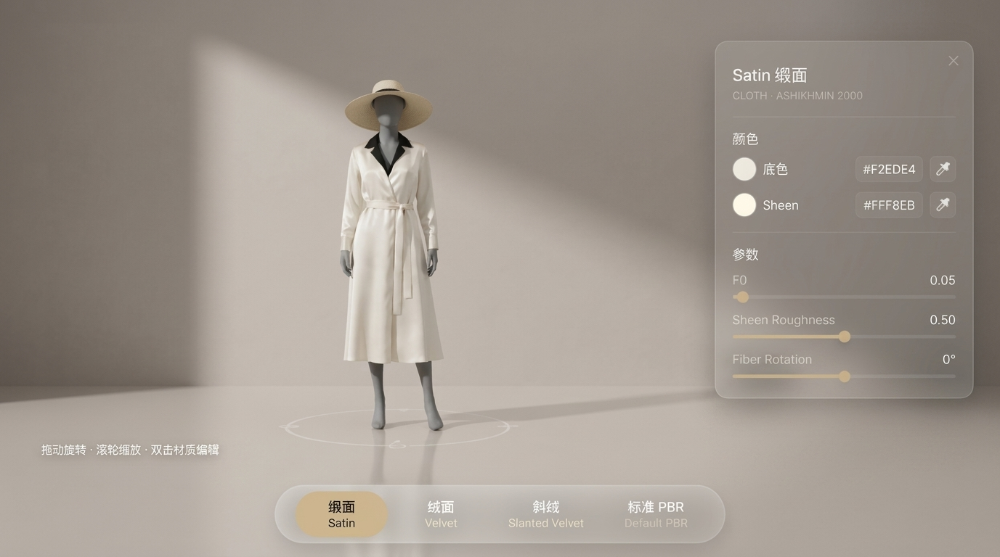
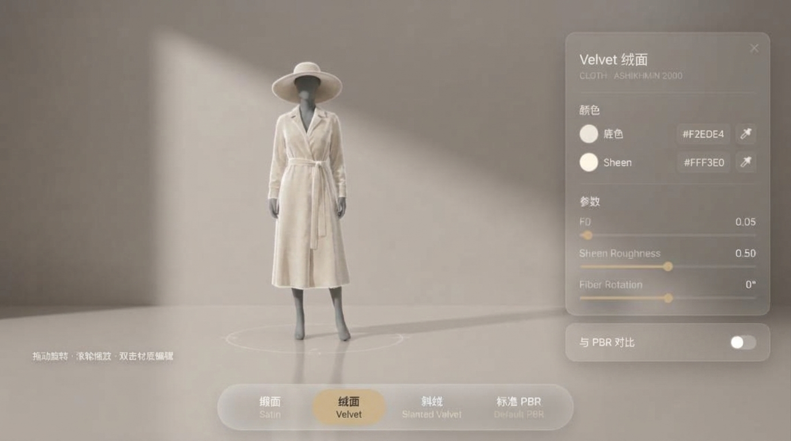
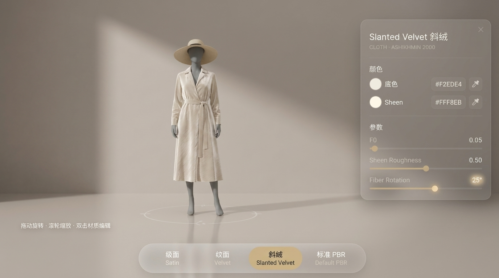

# Studio UI 设计系统（草案）

状态：2026-11-17 设计草案，**未实现**。这是 plan 文档，不是当前界面契约。
来源是布料材质展示界面的效果图（Gemini 生成），用途有两个：

1. 指导布料展示场景的 RmlUi 交互实现；
2. 作为后续编辑器大面积 UI 重构的样式基线——编辑器的面板、列表、属性行
   都按同一套令牌和组件规范做，不再各写一份 CSS。

当前界面契约仍然是 [game-ui-stack.md](../../contracts/game-ui-stack.md) 与
[ui-component-system.md](../../contracts/ui-component-system.md)。

## 参考图

三张图共同定义了“编辑态”：单人台居中，底部材质胶囊条，右侧滑出参数面板。
参考图里面板下方的“与 PBR 对比”开关**已决定不做**：对比通过直接点底部
`标准 PBR` 胶囊完成，面板只保留颜色与参数。

## 设计原则

- 3D 画面优先：UI 只占边缘，任何面板不得压住模特躯干。
- 一层玻璃：面板和胶囊条都是同一套半透明材质，不叠多层阴影。
- 暖中性色：米灰 + 暖金，只有选中态用强调色，其余靠透明度分级。
- 单一令牌源：颜色/字号/间距/圆角只来自本文档，场景 UI 与编辑器共用。
- 状态可读：选中、悬停、禁用必须靠填充和文字颜色区分，不靠加粗或发光。

## 设计令牌

### 颜色

| 令牌 | 值 | 用途 |
| --- | --- | --- |
| `--studio-wall` | `#8F867D` | 影棚墙面基色（3D，不是 UI） |
| `--studio-floor` | `#C1B8AF` | 影棚地面基色（3D，不是 UI） |
| `--panel-glass` | `rgba(64, 58, 52, 0.42)` | 参数面板底色（配合 18px 背景模糊） |
| `--panel-border` | `rgba(255, 255, 255, 0.16)` | 面板 1px 描边 |
| `--panel-divider` | `rgba(255, 255, 255, 0.10)` | 分组分隔线 |
| `--chip-bar` | `rgba(232, 228, 222, 0.38)` | 底部胶囊条底色（12px 模糊） |
| `--chip-border` | `rgba(255, 255, 255, 0.24)` | 胶囊条描边 |
| `--chip-hover` | `rgba(255, 255, 255, 0.14)` | 胶囊悬停填充 |
| `--accent` | `#D8BE8E` | 选中胶囊、滑杆填充、开关开启 |
| `--accent-strong` | `#C9AE7A` | 滑杆把手、强调描边 |
| `--text-primary` | `#FBF8F1` | 标题、数值、选中项文字 |
| `--text-secondary` | `#B6AFA7` | 英文副标、说明、未选中项 |
| `--text-on-accent` | `#3A332A` | 强调色上的文字 |
| `--danger` | `#C97B6A` | 仅用于破坏性操作，正常界面不出现 |

### 字体

- 家族：`Noto Sans SC`，回退系统无衬线。英文标签与数字使用同一家族的拉丁字形。
- 页面标题 22 / 600；面板标题 18 / 600；正文 13 / 400；数值 13 / 500 右对齐；
  英文副标 11 / 500，全大写，字距 `0.08em`。
- 行高：标题 1.3，正文 1.5，数值 1.2。

### 间距与尺寸

- 间距基数是 4：4 / 8 / 12 / 16 / 20 / 24 / 32。
- 面板内边距 20，分组之间 16，行间距 12。
- 面板宽度 340（1440 设计宽度），最大 30% 视口；高度自适应，距顶底各 40。
- 胶囊条高度 56，圆角全圆，条目内边距 `10 × 18`。
- 点击热区不小于 40 × 40。

### 形状与层次

- 圆角：面板 16，卡片 12，胶囊全圆，滑杆轨道全圆。
- 描边统一 1px；不使用 2px 以上的边框，不叠加外发光。
- 背景模糊：面板 18px，胶囊条 12px；模糊为 0 时回退到纯色底。
- 层次只有两级：画面 / 玻璃层。弹窗若出现，仍使用面板材质。

### 动效

- 面板滑入滑出 180ms，`cubic-bezier(0.2, 0.8, 0.2, 1)`，位移 24px + 透明度。
- 按钮悬停 120ms，仅改填充与文字色。
- 数值拖动实时更新，不做补间；滑杆把手 80ms 缩放反馈。
- 模态/面板打开期间不冻结 3D，旋转与缩放继续可用。

## 组件规范

### 材质胶囊条

- 结构：一条玻璃底 + 4 个条目，横向居中；条目 = 中文名（13/600）+ 英文名（11/500）。
- 状态：
  - 默认：透明底 + `--text-secondary`；
  - 悬停：`--chip-hover` + `--text-primary`；
  - 选中：`--accent` 实心 + `--text-on-accent`，英文副标降为 70% 不透明度；
  - 对照项（PBR）：默认饱和度 85%，选中后与其它项一致。
- 条目顺序固定：Satin / Velvet / Slanted Velvet / Default PBR。
- 点击即切换材质；若参数面板已打开，面板内容随选中项更新，不关闭。

### 参数面板

- 结构自上而下：标题行（中文名 + 英文副标 + 关闭按钮）、颜色分组、参数分组。
  不设“与 PBR 对比”开关卡片。
- 标题行高 48；分组标题 12/500 `--text-secondary`，上方 16 间距。
- 面板出现时模特不移动；相机轻微左移 3% 视口宽度保证不遮挡。
- 只允许一个面板实例；切换材质复用同一实例。
- 被修改过的参数（例如 `Fiber Rotation 25°`）数值用 `--accent` 高亮，
  未修改的保持 `--text-primary`；复位后恢复普通色。

### 颜色行

`[圆形色块 24] [标签 13] … [HEX 12 等宽] [吸管图标 28]`

- 色块带 1px 内描边，避免浅色与面板底混在一起。
- HEX 显示大写，点击可复制；吸管打开取色器（RmlUi 侧待实现）。
- 颜色分组固定两行：`底色`（albedo tint）与 `Sheen`（sheenColor）。

### 滑杆行

`[标签 13] … [数值 13 右对齐]` / 下面一条 4px 轨道，把手 12px。

- 轨道未填充部分 `rgba(255,255,255,0.18)`，填充 `--accent`，把手 `--accent-strong`。
- 拖动时数值跟随，不在拖动中重排布局；松开后提交参数。
- 键盘：左右方向键 ±1%，Shift 加速 ×10。

### 图标按钮

- 28 × 28 热区，图标 16px，默认 `--text-secondary`，悬停 `--text-primary`。
- 关闭按钮固定右上角，距边 16。

### 提示与转台

- 左下角提示文字 12/400 `rgba(255,255,255,0.62)`：`拖动旋转 · 滚轮缩放 · 双击材质编辑`。
- 首次交互后提示淡出，静止 3 秒后以 40% 透明度淡回。
- 模特脚下转台环：白色 8% 细线，选中材质时环线短暂增亮到 14%。

## 页面模板

### 浏览态（默认）

- 全屏 3D，无右侧面板；模特水平居中，头顶留 ~10% 空间，脚底在画面 88% 高度。
- 只保留：页面标题（可省）、底部胶囊条、左下提示、脚下转台环。
- 相机距离 600–700 cm，fov 35°，视线高度 90 cm。

### 编辑态

- 点击任一材质或底部条目后，右侧滑出参数面板（340 宽）。
- 3D 画面不缩放；相机左移让模特保持在“面板左侧区域”的视觉中心。
- 面板打开时胶囊条仍在，用于快速横向比较。

### 对照态

- 选中 `Default PBR` 时，面板隐藏“布料参数”里的 `Sheen` 相关项，
  只保留 `底色` 与粗糙度；标题副标换成 `DEFAULT LIT · PBR`。
- 从任一布料切到 PBR 时，胶囊条做 200ms 交叉淡出，避免跳变。

## 交互规范

| 输入 | 行为 |
| --- | --- |
| 左键拖动 | 水平旋转模特 0–360°，垂直俯仰限制 ±10°，松手保留角度 |
| 滚轮 | 相机推拉 50%–150%，带阻尼，最小距离 300 cm，最大 1200 cm |
| 双击材质 / 点击条目 | 切换材质并打开参数面板 |
| Esc / 面板关闭 | 关闭面板回到浏览态，材质保持不变 |
| 1–4 | 切换四种材质 |
| Space | 暂停/恢复自动旋转（若启用） |

拖动优先于 UI 命中：指针在面板或胶囊条上时不平移模特。
面板内的拖动不产生世界旋转。

## RmlUi 落地约定

- 文档：`ui/cloth-showcase.rml` + `ui/cloth-showcase.rcss`，令牌先抽到
  `ui/studio-tokens.rcss`，编辑器后续直接引用同一份。
- class：`studio-panel`、`studio-chip`、`studio-chip--selected`、
  `studio-row`、`studio-slider`、`studio-color-row`、`studio-hint`。
- 数据模型：继续用 `game_ui`，新增字段 `material_id`、`material_name`、
  `material_tag`、`f0`、`sheen_roughness`、`fiber_rotation`、`panel_open`。
- 事件地址：`material-select:<id>`、`panel-close`、`param-change:<key>`。
  控件只发值，不直接操作 World 或材质实例。
- 参数写回走材质实例运行时覆盖；材质切换需要一条运行时命令（当前缺失，
  见下方边界）。

## 当前引擎边界

- `MeshComponent.Material` 是 `internal set`，C# 不能在运行时改材质；
  需要一条 `mesh material <object> <MI 路径>` 运行时命令，或预加载后
  通过增删组件切换。
- 运行时 RmlUi 目前只有只读文本，没有按钮回调；需要最小事件桥
  （RmlUi action → 运行时命令/蓝图事件）。
- 材质实例参数是否支持运行时提交，取决于 MaterialInstance 预览提交路径；
  展示场景必须走同一条路径，不能私改渲染对象。

## 提示词存档（Gemini）

以下提示词用于继续生成缺失的状态图，风格必须与
`references/cloth-showcase-satin-edit.png` 保持一致。

### 默认浏览态

> 以同一套界面风格生成 1920×1080 的默认浏览态效果图：单人台模特站在浅灰米色
> 无缝影棚前，米白系带长裙、宽檐草帽、黑色内衬，哑光灰人台，地面微反光。
> **关闭右侧参数面板**，模特水平居中、全身入镜、头顶留 10% 空间，脚下有很淡的
> 圆形转台环。画面只保留：底部居中的四个材质胶囊（Satin 选中、Velvet、
> Slanted Velvet、Default PBR）和左下角小字「拖动旋转 · 滚轮缩放 · 双击材质编辑」。
> 不要出现任何面板、列表、弹窗、浏览器边框。柔和左前上方光，墙面有投影，
> 整体克制、留白多。

### Velvet 编辑态

> 同一场景与同一套 UI，但当前选中 **Velvet 绒面**：底部胶囊条里「绒面 / Velvet」
> 为暖金色实心选中态，其余为玻璃底。右侧滑出参数面板，标题「Velvet 绒面」，
> 副标 `CLOTH · ASHIKHMIN 2000`；颜色分组两行 `底色 #F2EDE4`、`Sheen #FFF3E0`；
> 参数分组三条滑杆 `F0 0.05`、`Sheen Roughness 0.50`、`Fiber Rotation 0°`；
> 底部一行「与 PBR 对比」开关。服装要明显呈现绒面质感：轮廓边缘有一圈柔和的
> 白色绒毛高光，明暗过渡比缎面更软更散，褶皱里不发锐利高光。模特不被面板遮挡。

### Slanted Velvet 编辑态

> 同一场景与同一套 UI，当前选中 **Slanted Velvet 斜绒**：胶囊条里「斜绒 /
> Slanted Velvet」为选中态。右侧面板标题「Slanted Velvet 斜绒」，副标
> `CLOTH · ASHIKHMIN 2000`；三条滑杆为 `F0 0.05`、`Sheen Roughness 0.50`、
> `Fiber Rotation 25°`（强调这一项）。服装质感要能看出“高光被斜向推开”：
> 裙摆褶皱上一侧亮、另一侧明显暗，亮带沿纤维方向倾斜而不是正对镜头；
> 帽檐同理。整体仍保持米白、柔和、无噪点。

## 后续

1. 把令牌抽成 `ui/studio-tokens.rcss`，先服务展示场景，再逐步替换
   `editor-workspace.rcss` 里的硬编码颜色。
2. 组件层按 `ui-component-system.md` 的 Slate 风格补齐：`ChipGroup`、
   `PropertyRow`、`ColorRow`、`Slider`、`GlassPanel`。
3. 编辑器重构按“令牌 → 组件 → 页面”的顺序推进，避免一次性改版面。
